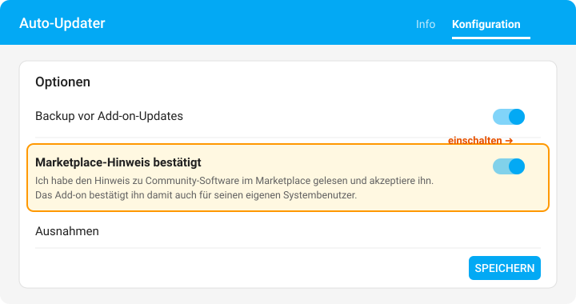

# Home Assistant Auto-Updater

Add-on für Home Assistant, das jede Nacht alle Updates installiert und so lange weitermacht, bis keine mehr offen
sind: Marketplace (früher HACS), Home Assistant Core, Home Assistant OS, Add-ons und Gerätefirmware.
Fehlgeschlagene Updates werden per Push gemeldet.

## Inhalt

1. [Installation](#1-installation)
2. [Einrichten](#2-einrichten)
3. [Marketplace-Hinweis bestätigen (ab 2026.11, wichtig)](#3-marketplace-hinweis-bestätigen-ab-202611-wichtig)
4. [Testen](#4-testen)
5. [Ablauf in der Nacht](#5-ablauf-in-der-nacht)
6. [Alle Optionen](#6-alle-optionen)
7. [Fehlersuche](#7-fehlersuche)

## 1. Installation

1. Den Button klicken und das Repository in Home Assistant hinzufügen.
   Ohne Button: **Einstellungen → Apps → App-Store → ⋮ → Repositories** und
   `https://github.com/bommel87/ha-auto-updater` eintragen.
2. **Auto-Updater** im Store öffnen und **Installieren** klicken. Das Add-on wird auf deinem Gerät gebaut, das dauert
   ein paar Minuten.
3. Noch **nicht** starten, erst einrichten.

## 2. Einrichten

Im Reiter **Konfiguration** des Add-ons:

| Option | Was eintragen |
|---|---|
| Startzeit | Uhrzeit für den nächtlichen Lauf, z. B. `01:00` |
| Ende des Zeitfensters | Danach werden keine neuen Updates mehr begonnen, z. B. `05:00` |
| Push-Dienst | Deine Benachrichtigungs-Aktion, z. B. `notify.mobile_app_mein_handy`. Den Namen findest du unter **Entwicklerwerkzeuge → Aktionen**, wenn du `notify.` eintippst |
| Update-Arten | Ein-/ausschalten, was automatisch aktualisiert werden soll |

**Speichern**, dann im Reiter **Info** das Add-on **starten**. Für dieses Add-on selbst kannst du dort auch
**Automatisch aktualisieren** einschalten.

## 3. Marketplace-Hinweis bestätigen (ab 2026.11, wichtig)

Seit Home Assistant 2026.11 ist HACS als **Marketplace** fest eingebaut. Bevor etwas aus dem Marketplace installiert
oder aktualisiert werden darf, muss der Hinweis zu Community-Software bestätigt werden – und zwar **von jedem
Benutzer einzeln**. Das Add-on arbeitet über einen eigenen Systembenutzer. Deine eigene Bestätigung gilt für diesen
Benutzer nicht.

Ohne Bestätigung lehnt Home Assistant jedes Marketplace-Update ab. Im Protokoll und in der Push steht dann:

> Marketplace-Hinweis für das Add-on nicht bestätigt: Option „Marketplace-Hinweis bestätigt“ einschalten

**So geht's:**

1. **Einstellungen → Marketplace** öffnen und den Hinweis lesen und für dich selbst akzeptieren.
2. Im Add-on unter **Konfiguration** den Schalter **Marketplace-Hinweis bestätigt** einschalten:

   

3. **Speichern** und das Add-on im Reiter **Info** **neu starten**.
4. Im **Protokoll** erscheint: `Marketplace-Hinweis für das Add-on bestätigt`.

Die Bestätigung bleibt gespeichert. Das Add-on wiederholt sie bei jedem Start, das schadet nicht.

## 4. Testen

**Ohne etwas zu installieren:**

1. In der Konfiguration **Testlauf** und **Beim Start ausführen** einschalten, speichern, Add-on neu starten.
2. Nach etwa 2 Minuten kommt eine Push mit allem, was installiert würde.
3. Beide Schalter wieder **ausschalten** und speichern.

**Echter Lauf sofort:** nur **Beim Start ausführen** einschalten, speichern, neu starten, danach den Schalter wieder
ausschalten. Achtung: Dabei wird wirklich installiert, und Home Assistant startet gegebenenfalls neu.

Den Verlauf siehst du im Reiter **Protokoll**.

## 5. Ablauf in der Nacht

Jede Runde:

1. Add-ons (mit Backup), Gerätefirmware, Marketplace
2. Home Assistant Core (mit Backup) – Home Assistant startet neu, das Add-on wartet
3. Home Assistant OS – der Host startet neu, danach setzt das Add-on den Lauf fort
4. Gab es nur Marketplace-Updates, startet Home Assistant einmal neu, damit sie aktiv werden

Danach beginnt die nächste Runde, bis nichts mehr offen ist oder das Zeitfenster endet.

- Jedes Update wird pro Nacht höchstens zweimal versucht.
- Firmware, die im Hintergrund installiert wird (z. B. Shelly), wird bis zu 20 Minuten abgewartet.
- Übersprungene Updates (in Home Assistant „Überspringen“) werden ignoriert.
- Der Supervisor und das Add-on selbst werden nicht angefasst.

## 6. Alle Optionen

| Option | Standard | Bedeutung |
|---|---|---|
| Startzeit | `01:00` | Beginn des nächtlichen Laufs |
| Ende des Zeitfensters | `05:00` | Danach keine neuen Updates mehr |
| Push-Dienst | – | Ziel für Push-Nachrichten, leer = Benachrichtigung in Home Assistant |
| Auch Erfolge melden | aus | Zusätzlich eine Push mit allen installierten Updates |
| Marketplace (früher HACS) | an | Integrationen, Karten und Themes aus dem Marketplace |
| Home Assistant Core | an | |
| Home Assistant OS | an | |
| Add-ons | an | |
| Gerätefirmware | an | ESPHome, UniFi, Shelly, Zigbee-Funkmodul usw. |
| Backup vor Core-Update | an | |
| Backup vor Add-on-Updates | an | Diese Backups löscht Home Assistant nicht automatisch – ab und zu aufräumen |
| Marketplace-Hinweis bestätigt | aus | Siehe [Abschnitt 3](#3-marketplace-hinweis-bestätigen-ab-202611-wichtig) |
| Ausnahmen | – | Update-Entitäten, die nie automatisch installiert werden, z. B. `update.home_assistant_core_update` |
| Testlauf | aus | Nichts installieren, nur melden |
| Beim Start ausführen | aus | Lauf sofort beim Start des Add-ons |

## 7. Fehlersuche

| Meldung | Ursache und Lösung |
|---|---|
| `Marketplace-Hinweis für das Add-on nicht bestätigt` | [Abschnitt 3](#3-marketplace-hinweis-bestätigen-ab-202611-wichtig) |
| `Home Assistant noch nicht erreichbar: HTTP Error 502` | Normal während eines Neustarts |
| `Zeitfenster vorbei` | Der Lauf hat bis zum Ende des Zeitfensters nicht alles geschafft; der Rest folgt in der nächsten Nacht |
| Update fehlgeschlagen ohne klaren Grund | **Einstellungen → System → Protokolle** prüfen und das Update einmal von Hand installieren |
